

  <a href="https://www.loganmedwardsastrophy.com/"><picture><source media="(max-width: 600px)" srcset="docs/banner-compact.svg"></picture></a>
   
  <picture><source media="(prefers-reduced-motion: reduce)" srcset="docs/typing-still.svg"></picture>
   
  
  
  
  

I'm an Astronomy & Astrophysics student at Florida Tech, double majoring in Planetary Science. Most of the work here is about asteroids. I built a catalog of about 1.58 million of them and a pipeline that estimates whether mining one would make money, then used the catalog for a [paper](https://github.com/loggger101/asteroid-belt-gradient) on whether the belt's S/C composition gradient shows where its asteroids formed. Corrected for two biases, the switch from S-types to C-types turns out too gradual for a snow line they formed behind, which points to carbonaceous asteroids carried in from beyond Jupiter. I've also mapped landforms across Mars from orbital imagery, trained two image classifiers and written an orbit simulator.

Outside of school I'm CTO of [AspireCURES](https://www.aspirecures.com), a company that matches patients with rare brain diseases to research, and VP of Database Management at [Sisters Hope Foundation](https://www.sistershopefoundation.org), a rare-disease nonprofit. I run the websites and patient databases for both.

  <a href="#-space-economics">Space economics</a> · <a href="#-planetary-science">Planetary science</a> · <a href="#-deep-learning">Deep learning</a> · <a href="#-simulation">Simulation</a> · <a href="#-rare-disease-work">Rare-disease work</a> · <a href="#-elsewhere">Elsewhere</a> · <a href="#-every-commit-so-far">Commits</a> · <a href="#-languages">Languages</a> · <a href="#-passing-earth-this-week">Flybys</a> · <a href="#-get-in-touch">Contact</a>

  <a href="https://github.com/loggger101/AsteroidCatalog"><picture><source media="(max-width: 600px)" srcset="docs/stats/catalog-compact.svg"></picture></a>
  <a href="https://github.com/loggger101/asteroid-belt-gradient"><picture><source media="(max-width: 600px)" srcset="docs/stats/belt-compact.svg">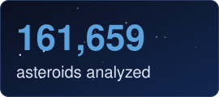</picture></a>
  <a href="https://github.com/loggger101/General_Research"><picture><source media="(max-width: 600px)" srcset="docs/stats/sources-compact.svg"></picture></a>
  <a href="https://github.com/loggger101/Hermes_Skills"><picture><source media="(max-width: 600px)" srcset="docs/stats/skills-compact.svg"></picture></a>

  <a href="https://github.com/loggger101/Satellite-Space-Flight"><picture><source media="(prefers-reduced-motion: reduce) and (max-width: 600px)" srcset="docs/gallery/satellite-compact.webp"><source media="(prefers-reduced-motion: reduce)" srcset="docs/gallery/satellite.webp"><source media="(max-width: 600px)" srcset="docs/gallery/satellite-motion-compact.webp">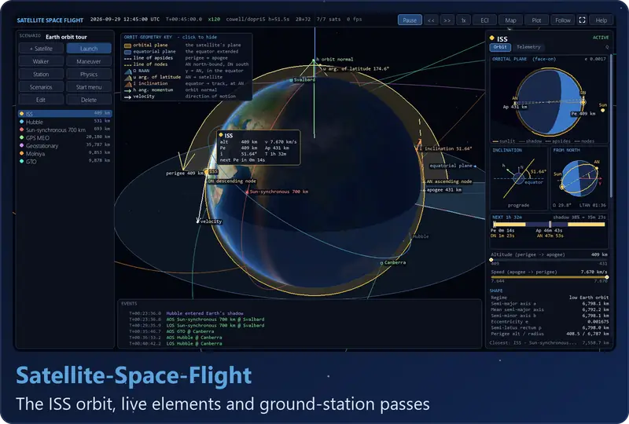</picture></a>
  <a href="https://github.com/loggger101/asteroid-belt-gradient"><picture><source media="(max-width: 600px)" srcset="docs/gallery/belt-compact.webp">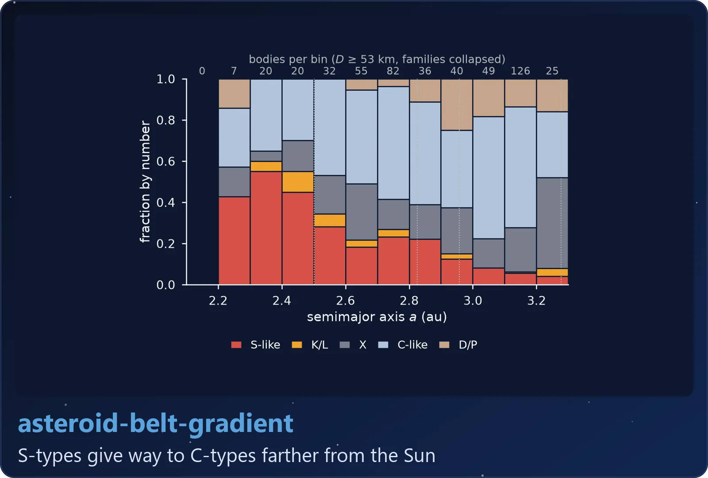</picture></a>
  <a href="https://github.com/loggger101/Mars_Terrestrial_GlobalMosaic_GIS-Data"><picture><source media="(prefers-reduced-motion: reduce) and (max-width: 600px)" srcset="docs/gallery/mars-compact.webp"><source media="(prefers-reduced-motion: reduce)" srcset="docs/gallery/mars.webp"><source media="(max-width: 600px)" srcset="docs/gallery/mars-motion-compact.webp">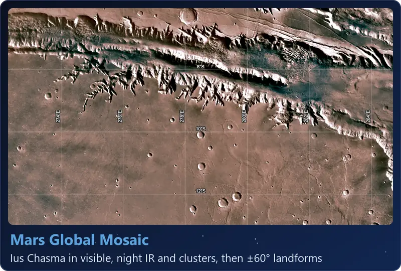</picture></a>
  <a href="https://github.com/loggger101/drone-target-id"><picture><source media="(prefers-reduced-motion: reduce) and (max-width: 600px)" srcset="docs/gallery/drone-compact.webp"><source media="(prefers-reduced-motion: reduce)" srcset="docs/gallery/drone.webp"><source media="(max-width: 600px)" srcset="docs/gallery/drone-motion-compact.webp">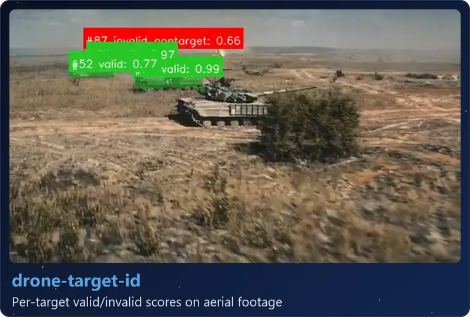</picture></a>
  <a href="https://github.com/loggger101/AsteroidCatalog"><picture><source media="(max-width: 600px)" srcset="docs/gallery/catalog-compact.webp">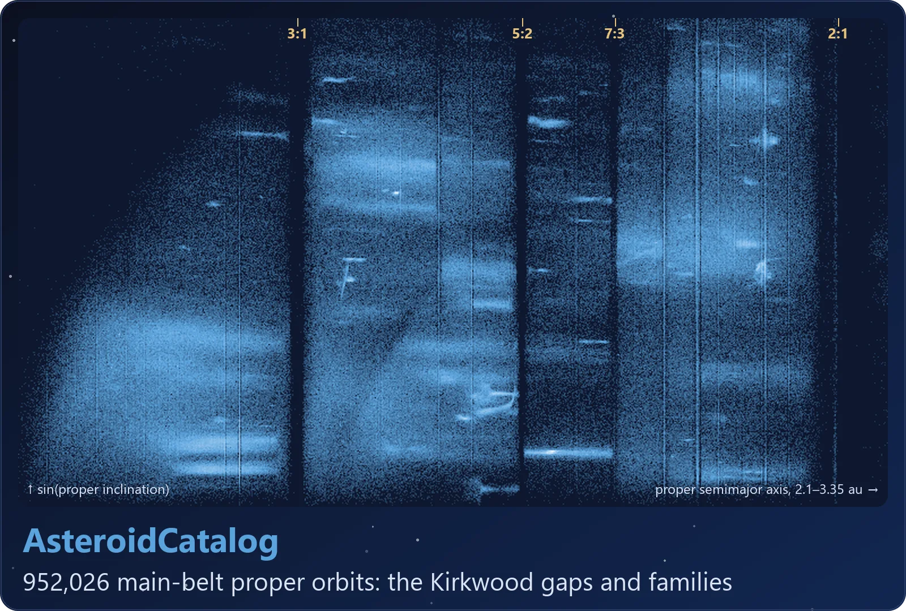</picture></a>
  <a href="https://github.com/loggger101/star-spectral-classifier"><picture><source media="(max-width: 600px)" srcset="docs/gallery/star-compact.webp">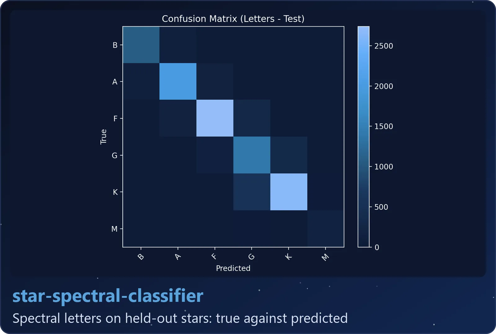</picture></a>

### <picture></picture> Space economics

The first five repos work together to estimate whether an uncrewed asteroid mining mission would turn a profit, and the sixth checks the pipeline against other people's code. The catalog also feeds my paper.

  <picture><source media="(max-width: 600px)" srcset="docs/pipeline-compact.svg"></picture>

<table>
  <tr>
    <td width="24%" valign="top"><b><a href="https://github.com/loggger101/economicspace">economicspace</a></b> the pipeline 23,188 lines of code 95,267 total lines <picture></picture></td>
    <td valign="top">
The main pipeline. It installs a pinned catalog release from AsteroidCatalog and pinned prices from spacevalue, costs the transport with spacecost, then runs the rocket equation and a cost cascade to rank targets by profit.
<picture></picture> <picture></picture> <picture></picture></td>
  </tr>
  <tr>
    <td width="24%" valign="top"><b><a href="https://github.com/loggger101/AsteroidCatalog">AsteroidCatalog</a></b> Stage 1: the catalog 6,214 lines of code 14,600 total lines <picture></picture></td>
    <td valign="top">
The pipeline's catalog stage, moved into its own repo. About 1.58 million asteroids from JPL SBDB, SsODNet, NEOWISE and MP3C, cross-matched, with the source of every value recorded and a cited composition estimate for each taxonomy class. Releases are frozen so other projects can pin one.
<picture></picture> <picture></picture>  </td>
  </tr>
  <tr>
    <td width="24%" valign="top"><b><a href="https://github.com/loggger101/spacevalue">spacevalue</a></b> Stage 2: mineral prices 3,470 lines of code 7,965 total lines <picture></picture></td>
    <td valign="top">
The pipeline's pricing stage as an installable Python package: what a kilogram of each mineral and element is worth at eight places you could deliver it, from Earth's surface to Mars. Away from Earth a material is worth the better of being used there, which saves launching it, or being flown home and sold. Prices come from recorded quotes, so a build can be repeated, and each dated release carries all eight tables as CSVs.
<picture></picture> <picture></picture> </td>
  </tr>
  <tr>
    <td width="24%" valign="top"><b><a href="https://github.com/loggger101/spacecost">spacecost</a></b> Stage 3: mission costs 9,401 lines of code 18,783 total lines <picture></picture></td>
    <td valign="top">
The pipeline's mission-cost stage as an installable Python package: reference tables for mission cost and mass, with a citation on every row.
<picture></picture> <picture></picture>  </td>
  </tr>
  <tr>
    <td width="24%" valign="top"><b><a href="https://github.com/loggger101/General_Research">General_Research</a></b> the sources 2,555 lines of code 75,040 total lines <picture></picture></td>
    <td valign="top">
The sources behind the four repos above, ranked into tiers by authority, with the numbers I use pulled into a CSV for each source.
</td>
  </tr>
  <tr>
    <td width="24%" valign="top"><b><a href="https://github.com/loggger101/starred-repos">starred-repos</a></b> pipeline audit 3,864 lines of code 11,530 total lines <picture></picture></td>
    <td valign="top">
An audit of 17 repos I'd starred, read for code and data the pipeline could use, and then of 194 more. Its probe scripts check economicspace's delta-v estimates against JPL's NHATS and against optimized Lambert transfers, and found two errors that partly cancel: the plane change is overcharged, and the transfer geometry undercharged by more. A later probe showed that most of the 1.39 km/s gap to JPL's outbound legs is the round trip: a one-way search on the same dates sits only 0.36 km/s above the pipeline's estimate. Others found that a guessed taxonomy is right about half the time, and that 42 of the 69 near-Earth asteroids in the ranking's top 100 can't be observed again before 2036.
<picture></picture> <picture></picture> <picture></picture></td>
  </tr>
</table>

**Where it stands.** One row for each place the pipeline can deliver to, from its latest full-catalog runs: what the best mission costs for each dollar its cargo earns (filled dot) and what the median asteroid's does (open dot). Left of the dashed line, a mission pays for itself; none does yet.

  <picture><source media="(max-width: 600px)" srcset="docs/breakeven-compact.svg"></picture>

**What it rests on.** The 742 sources in General_Research, in 30 domains, one bar for each, split by authority: T1 peer-reviewed papers, T2 NASA, ESA and AIAA reports, T3 government data with a DOI, and T4 grey sources such as company documents, price pages and my own audit records of pinned code. 62% are T1 or T2. The biggest, launch economics with 153, is mostly grey sources (118).

  <picture><source media="(max-width: 600px)" srcset="docs/sources-compact.svg"></picture>

### <picture></picture> Planetary science

<table>
  <tr>
    <td width="24%" valign="top"><b><a href="https://github.com/loggger101/asteroid-belt-gradient">asteroid-belt-gradient</a></b> paper and code 3,148 lines of code 6,938 total lines <picture></picture></td>
    <td valign="top">
Code and paper for <i>Constraints on the Origin of the Asteroid Belt's Compositional Gradient from Debiased Taxonomic Data</i>. It tests whether the belt's switch from S-types to C-types dates back to formation, using 161,659 classified asteroids from AsteroidCatalog after collapsing collisional families and correcting for the brightness bias that favors S-types. The code rebuilds every figure and number in the paper from two public input files.
<picture></picture> <picture></picture> <picture></picture>  </td>
  </tr>
  <tr>
    <td width="24%" valign="top"><b><a href="https://github.com/loggger101/Mars_Terrestrial_GlobalMosaic_GIS-Data">Mars Global Mosaic</a></b> Mars GIS mapping 28,231 lines of code 1,626,417 total lines <picture></picture></td>
    <td valign="top">
My project for OCN 4704 (Remote Sensing). In ArcGIS Pro I lined up Viking color, THEMIS day and night infrared, and HRSC/MOLA elevation between 60°N and 60°S to map lava flows, river channels and impact craters. A support vector machine classifies the landforms across that whole band, scoring 73.8% on areas it never trained on, and I've since trained RetinaNet and U-Net models to compare against it. I'm now widening the map from four classes to seven for the final paper, due 8 December; on the reviewed seven-class labels a U-Net already scores 69.0% on held-out areas, against 42.5% for the SVM, a lead that rests on two blocks around Tharsis.
<picture></picture> <picture></picture> </td>
  </tr>
</table>

**What it found.** One row for each sample the paper fits, the raw count first. The dot is where C-types reach half of the asteroids, with its bootstrap range, and the bar runs from 10% to 90%. The raw count puts it at 2.84 au. Corrected, the turn sits at 2.41–2.47 au, inside the snow line at 2.67 au, and takes 1.4–1.5 au to go from 10% to 90% C-types, wider than the belt itself. A snow line the asteroids formed behind would leave a sharp step, so the paper favors C-types carried in from beyond Jupiter.

  <picture><source media="(max-width: 600px)" srcset="docs/crossover-compact.svg"></picture>

Four figures from the asteroid-belt-gradient paper (each links to the full size):

  <a href="https://github.com/loggger101/asteroid-belt-gradient/blob/main/figures/fig1_c_fraction_vs_a.png"><picture><source media="(max-width: 600px)" srcset="docs/figures/belt-fraction-compact.webp">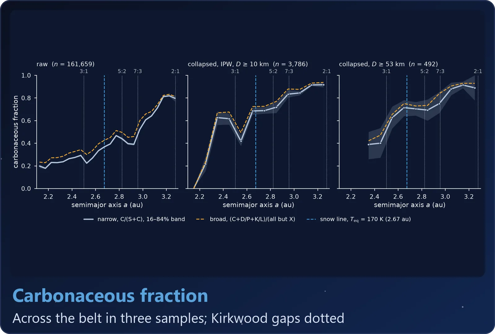</picture></a>
  <a href="https://github.com/loggger101/asteroid-belt-gradient/blob/main/figures/fig7_crossover_fits.png"><picture><source media="(max-width: 600px)" srcset="docs/figures/belt-crossover-compact.webp">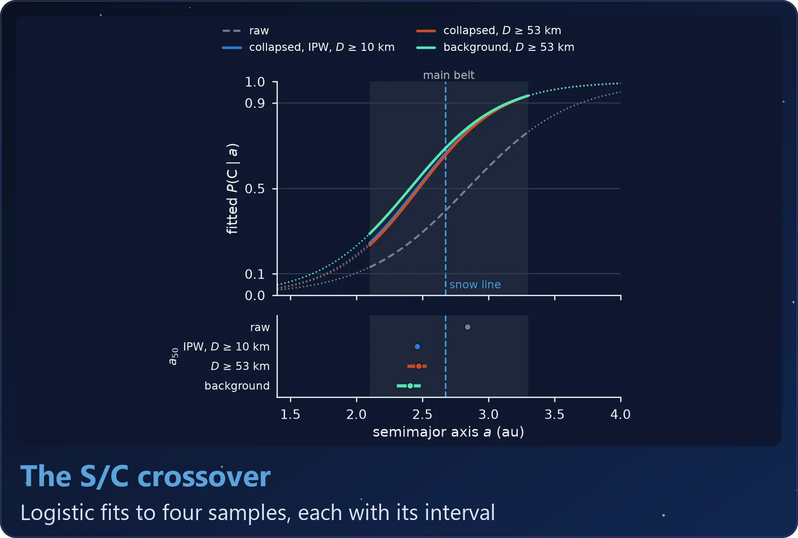</picture></a>
  <a href="https://github.com/loggger101/asteroid-belt-gradient/blob/main/figures/fig6_size_distance_map.png"><picture><source media="(max-width: 600px)" srcset="docs/figures/belt-size-distance-compact.webp">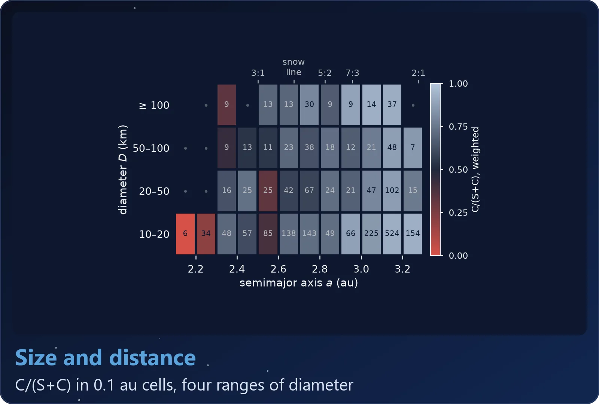</picture></a>
  <a href="https://github.com/loggger101/asteroid-belt-gradient/blob/main/figures/fig8_proper_elements.png"><picture><source media="(max-width: 600px)" srcset="docs/figures/belt-proper-compact.webp">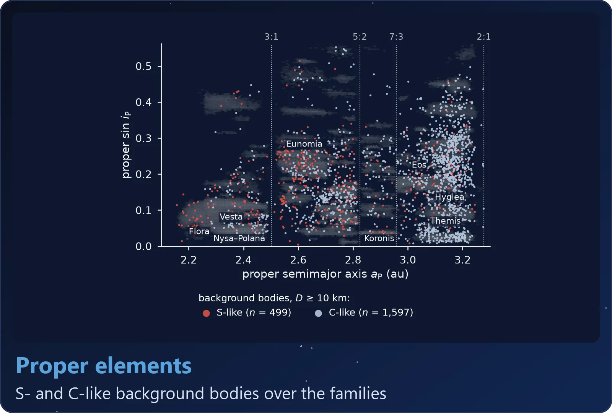</picture></a>

Four maps from the Mars project (each links to its full sheet):

  <a href="https://github.com/loggger101/Mars_Terrestrial_GlobalMosaic_GIS-Data/blob/main/Mars%20Project/Global60/layouts/08_global60_mosaic.png"><picture><source media="(max-width: 600px)" srcset="docs/figures/mars-topography-compact.webp">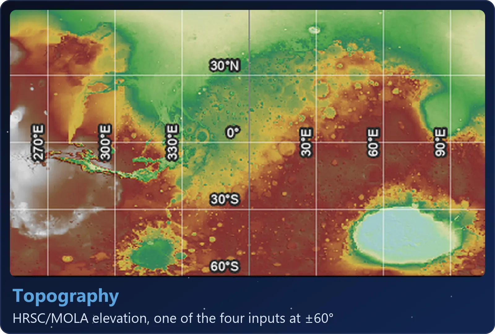</picture></a>
  <a href="https://github.com/loggger101/Mars_Terrestrial_GlobalMosaic_GIS-Data/blob/main/Mars%20Project/Global60/layouts/15_athabasca_type_area.png"><picture><source media="(max-width: 600px)" srcset="docs/figures/mars-athabasca-compact.webp">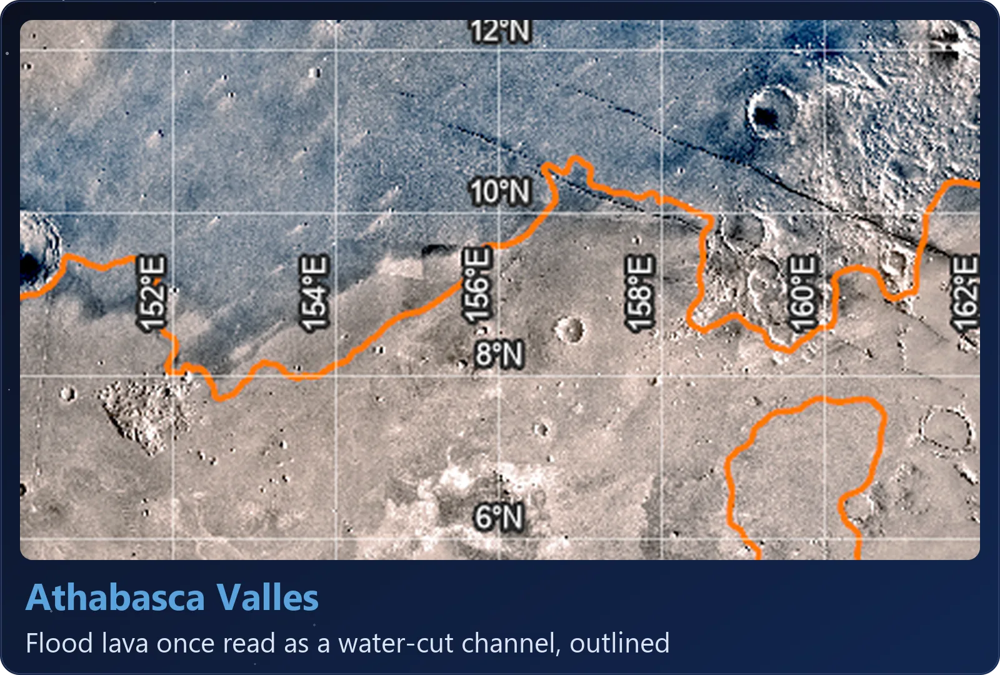</picture></a>
  <a href="https://github.com/loggger101/Mars_Terrestrial_GlobalMosaic_GIS-Data/blob/main/Mars%20Project/Global60/layouts/16_x5_detections.png"><picture><source media="(max-width: 600px)" srcset="docs/figures/mars-retinanet-compact.webp">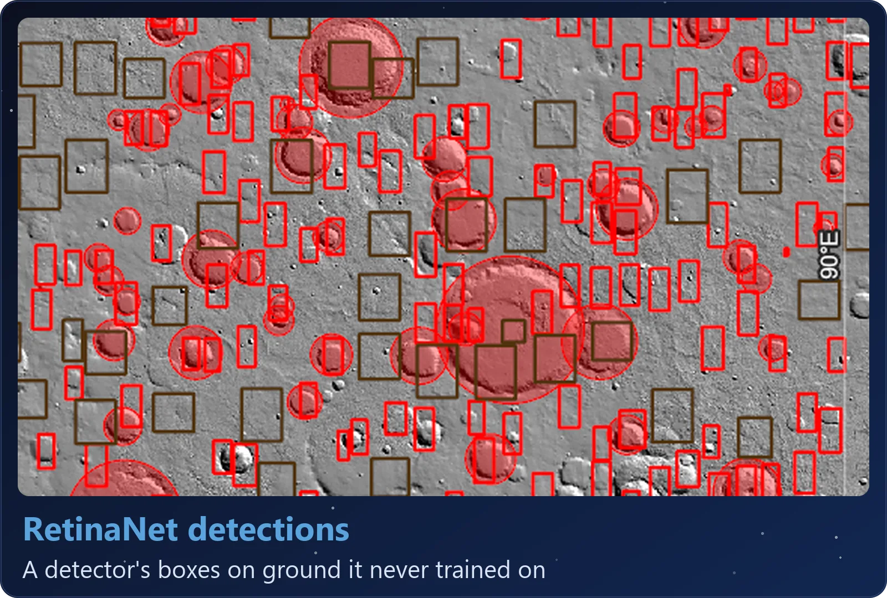</picture></a>
  <a href="https://github.com/loggger101/Mars_Terrestrial_GlobalMosaic_GIS-Data/blob/main/Mars%20Project/Global60/layouts/17b_unet_v2_provinces.png"><picture><source media="(max-width: 600px)" srcset="docs/figures/mars-unet-compact.webp">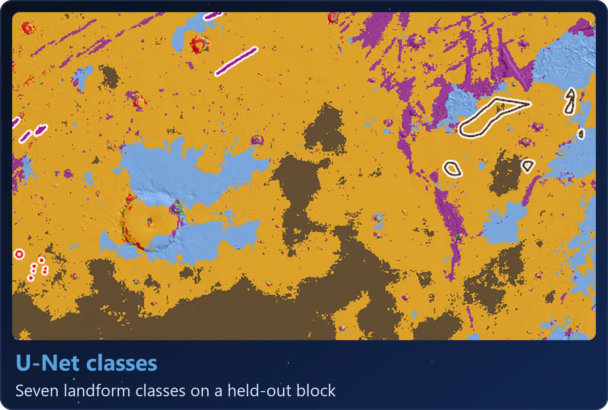</picture></a>

### <picture></picture> Deep learning

<table>
  <tr>
    <td width="24%" valign="top"><b><a href="https://github.com/loggger101/star-spectral-classifier">star-spectral-classifier</a></b> stellar classification 2,946 lines of code 7,333 total lines <picture></picture></td>
    <td valign="top">
A multi-task CNN that predicts a star's Morgan-Keenan spectral letter and subclass digit from Pan-STARRS color cutouts, without any spectra. On 14k held-out cutouts it gets the letter right 84.3% of the time, and 98.4% within its top two guesses. Finished October 2025.
<picture></picture> <picture></picture>  </td>
  </tr>
  <tr>
    <td width="24%" valign="top"><b><a href="https://github.com/loggger101/drone-target-id">drone-target-id</a></b> aerial target ID 1,509 lines of code 4,779 total lines <picture></picture></td>
    <td valign="top">
YOLO finds and segments targets in aerial footage, then a multi-output CNN gives each one a fine class and a valid/invalid call. On a 27k held-out test set it scores 87.1% on fine class and 91.3% on valid/invalid. Finished December 2025.
<picture></picture> <picture></picture> <picture></picture>  </td>
  </tr>
</table>

How each model's mistakes fall on held-out data (each links to the full size):

  <a href="https://github.com/loggger101/star-spectral-classifier/blob/main/results/confusion_matrix_combined_test.png"><picture><source media="(max-width: 600px)" srcset="docs/figures/dl-star-matrix-compact.webp">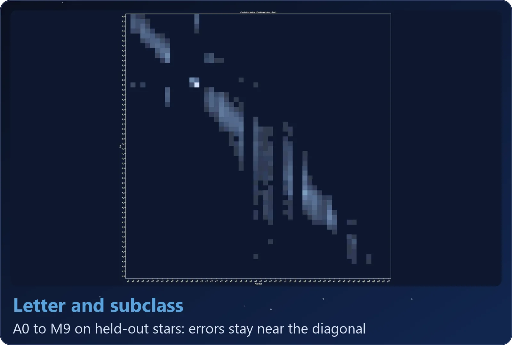</picture></a>
  <a href="https://github.com/loggger101/drone-target-id/blob/main/results/final_confusion_fine.png"><picture><source media="(max-width: 600px)" srcset="docs/figures/dl-drone-matrix-compact.webp">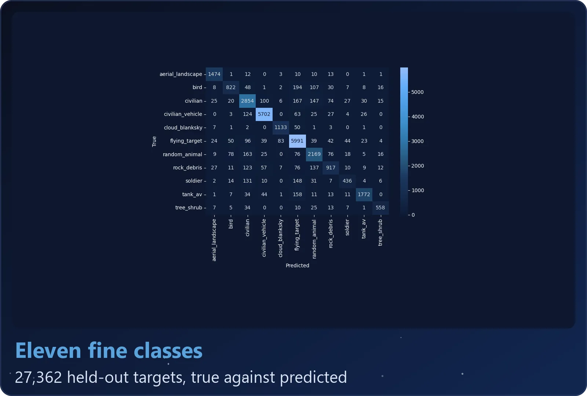</picture></a>

### <picture></picture> Simulation

<table>
  <tr>
    <td width="24%" valign="top"><b><a href="https://github.com/loggger101/Satellite-Space-Flight">Satellite-Space-Flight</a></b> orbit simulator 16,396 lines of code 26,587 total lines <picture></picture></td>
    <td valign="top">
A 3-D Earth orbit simulator in pure Python. The physics runs in numpy (J2 to J4 gravity, drag, Sun and Moon, solar radiation pressure, maneuvers) and pygame draws it. You can also fly a multi-stage rocket to orbit from anywhere on Earth, or from one of fifteen real launch complexes. A MATLAB toolkit builds scenarios and plots the results, and a running simulation exports as a live script that runs again inside MATLAB with no Python; satellites in orbit agree with the simulator to within meters over hours.
<picture></picture> <picture></picture> <picture></picture> <picture></picture></td>
  </tr>
</table>

Four of the scenes it draws for its own README (each links to the full size):

  <a href="https://github.com/loggger101/Satellite-Space-Flight/blob/main/docs/images/hohmann.png"><picture><source media="(max-width: 600px)" srcset="docs/figures/sim-hohmann-compact.webp">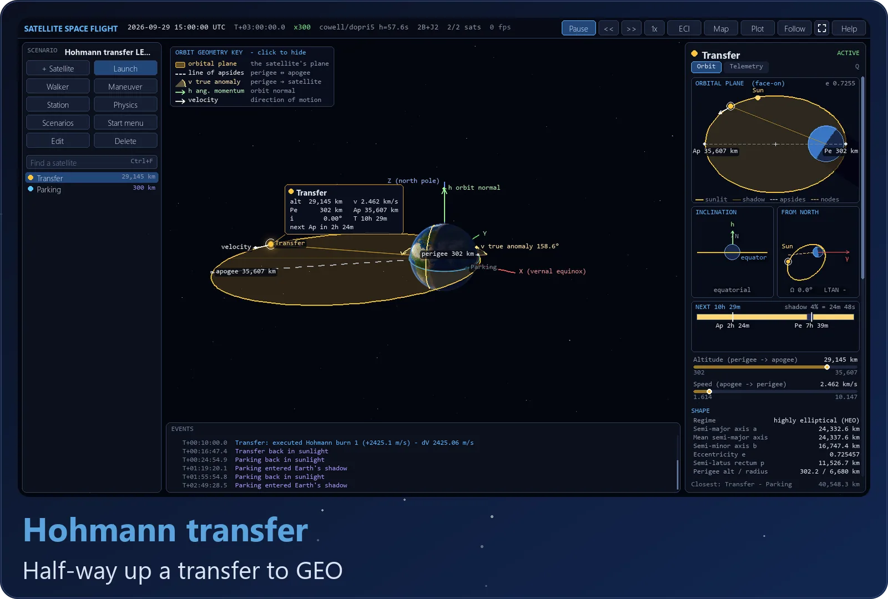</picture></a>
  <a href="https://github.com/loggger101/Satellite-Space-Flight/blob/main/docs/images/starlink.png"><picture><source media="(max-width: 600px)" srcset="docs/figures/sim-starlink-compact.webp">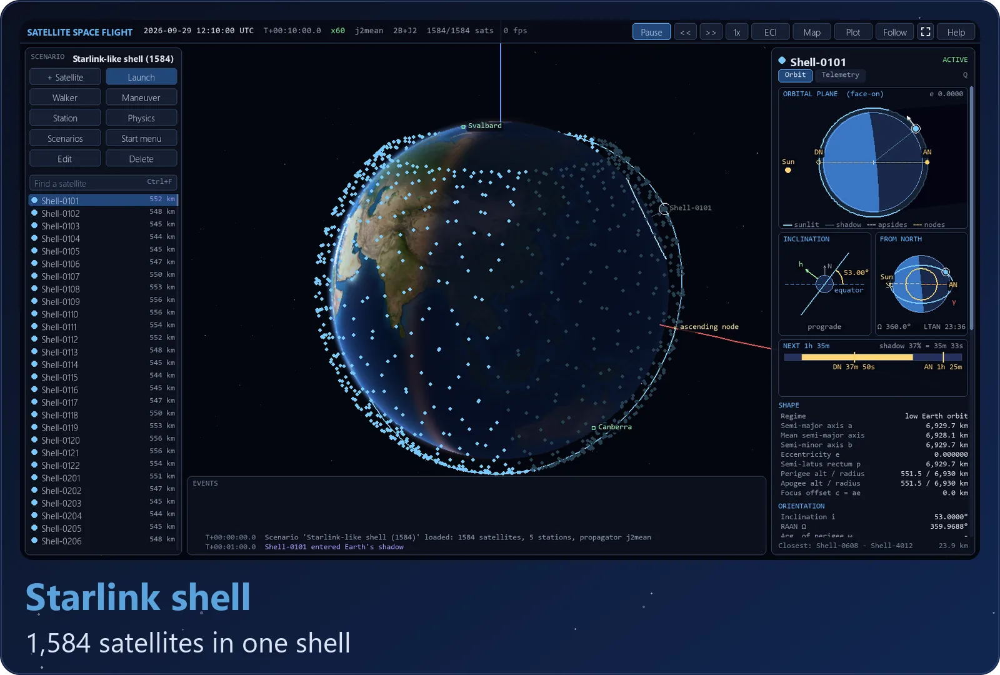</picture></a>
  <a href="https://github.com/loggger101/Satellite-Space-Flight/blob/main/docs/images/molniya_ecef_map.png"><picture><source media="(max-width: 600px)" srcset="docs/figures/sim-molniya-compact.webp">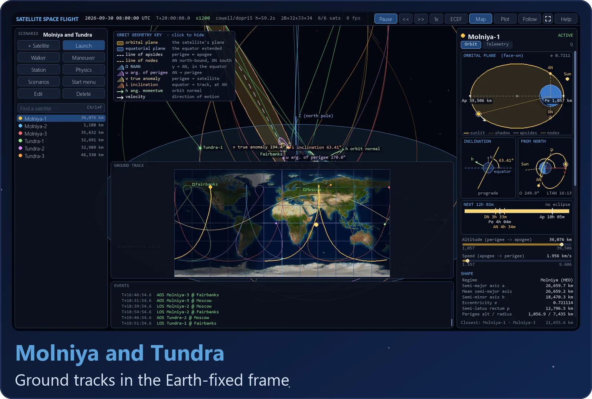</picture></a>
  <a href="https://github.com/loggger101/Satellite-Space-Flight/blob/main/docs/images/launch_ascent.png"><picture><source media="(max-width: 600px)" srcset="docs/figures/sim-launch-compact.webp">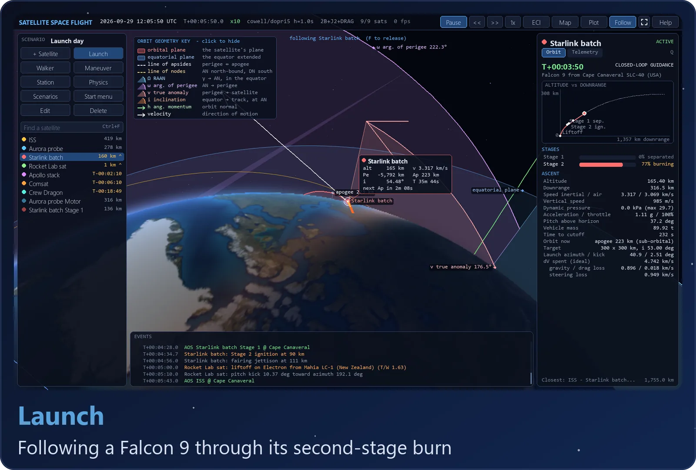</picture></a>

### <picture></picture> Rare-disease work

Both repos are private, but the sites are public.

<table>
  <tr>
    <td width="24%" valign="top"><b><a href="https://www.aspirecures.com">AspireCURES</a></b> CTO 10,683 lines of code 20,805 total lines <picture></picture></td>
    <td valign="top">
AspireCURES connects patients with rare brain diseases such as CSF1R-ALSP to clinical trials, studies and specialists. Its site runs on Cloudflare Pages with serverless registration, and I've built a weekly research feed for its nine disease pages.
<picture></picture>  </td>
  </tr>
  <tr>
    <td width="24%" valign="top"><b><a href="https://www.sistershopefoundation.org">Sisters Hope Foundation</a></b> VP, Database Management 5,219 lines of code 11,270 total lines <picture></picture></td>
    <td valign="top">
Sisters Hope is a 501(c)(3) patient advocacy group for ALSP and CSF1R-related disorders. I moved their site off Squarespace and onto Cloudflare Pages.
<picture></picture> </td>
  </tr>
</table>

### <picture></picture> Elsewhere

<!-- GitHub sizes each table to its content. Two of these descriptions are short, so the spacer image (1px tall, transparent) widens the table to match the others; on phones it shrinks to nothing. -->
<table>
  <tr>
    <td width="24%" valign="top"><b><a href="https://github.com/loggger101/website">website</a></b> portfolio site 7,615 lines of code 10,124 total lines <picture></picture></td>
    <td valign="top">
The code for my portfolio site. Plain HTML, CSS and JavaScript with no build step.
<picture></picture> <picture></picture> <picture></picture>   <picture></picture></td>
  </tr>
  <tr>
    <td width="24%" valign="top"><b><a href="https://github.com/loggger101/quietlaunch">quietlaunch</a></b> Streamlit launcher 1,094 lines of code 2,359 total lines <picture></picture></td>
    <td valign="top">
Starts a Streamlit app with no console window. A small control window shows the server booting, and why it failed if it does, opens the browser once the port answers, and stops the server and its children when closed. I split it out of economicspace's dashboard launcher; it uses only the standard library and is tested on Windows, Linux and macOS.
<picture></picture> <picture></picture> </td>
  </tr>
  <tr>
    <td width="24%" valign="top"><b><a href="https://github.com/loggger101/quietqueue">quietqueue</a></b> unattended job queue 653 lines of code 1,714 total lines <picture></picture></td>
    <td valign="top">
Runs a queue of long jobs unattended on Windows and keeps it alive through a closed shell, a stray Ctrl+C, a reboot or a second copy started at logon. Each job is one subprocess, a ledger records what's finished so a restart picks up where it stopped, and the whole process tree can be paused and resumed without losing the job in flight. I split it out of economicspace's campaign runner, which ran a 28-job model campaign over several days.
<picture></picture> </td>
  </tr>
  <tr>
    <td width="24%" valign="top"><b><a href="https://github.com/loggger101/samebytes">samebytes</a></b> bit-identity checks 2,057 lines of code 4,453 total lines <picture></picture></td>
    <td valign="top">
Checks that two sets of bytes really are the same, in three places where they quietly aren't: a synced folder (OneDrive, Google Drive) serving stale files while <code>git status</code> stays clean, a second machine that can't reproduce floating-point results bit for bit, and two pandas runs that a careless comparison calls different. It also records what produced a run when it happens, and ships a git hook that repairs git's stat cache in a synced folder. I split it out of economicspace, whose releases are argued from bit-identical output; it needs only the standard library, and CI runs it on Windows, Linux and macOS.
<picture></picture> <picture></picture> <picture></picture> </td>
  </tr>
  <tr>
    <td width="24%" valign="top"><b><a href="https://github.com/loggger101/Hermes_Skills">Hermes_Skills</a></b> agent skills <picture></picture></td>
    <td valign="top">
My library of 253 agent skills in 23 categories, built for my Hermes agent setup.
<picture></picture> <picture></picture></td>
  </tr>
</table>

### <picture></picture> Every commit so far

Every commit I've made to the repos above, from the first to this week. Each ring is one section of this page, the outermost the first; time runs clockwise from twelve o'clock, and a bigger dot is a busier week. Bots' commits aren't counted.

  <picture><source media="(max-width: 600px)" srcset="docs/activity-compact.svg"></picture>

My latest commits:

<!-- latest commits -->
- 5 Nov · [spacevalue](https://github.com/loggger101/spacevalue/commit/e3d87f7e72ec43d8db06e4807bad9429597e1bea): sold\_as\_is: the as-is route as a table a mission search can try (0.5.0)
- 5 Nov · [spacevalue](https://github.com/loggger101/spacevalue/commit/29ec0696155984b4754f2f0e3e88ceedc498c0da): One in-space demand class is one market (rc-261, contract 1.19.0)
- 5 Nov · [economicspace](https://github.com/loggger101/economicspace/commit/8a9a226f5fe857b6d60a50565ddfa78754302ea9): Skip combos that provably cannot beat the incumbent (master v1.68.0, calc v1.41.0)
- 5 Nov · [economicspace](https://github.com/loggger101/economicspace/commit/6ff87e6bd8c82c796a71643f00db0a3465b81cca): versions.md: twenty-nine stamps that are not performance-only (no stamp)
- 5 Nov · [Satellite-Space-Flight](https://github.com/loggger101/Satellite-Space-Flight/commit/e94c3d0d706b3b76763218495c1c82690f50e893): MATLAB toolkit and Export MATLAB live scripts
- 5 Nov · [Mars Global Mosaic](https://github.com/loggger101/Mars_Terrestrial_GlobalMosaic_GIS-Data/commit/342be45c88860b92c722cb2d91871c40084c72a1): Freeze edits tried on a scratch copy; the committed paper PDF rebuilt, 21 pages
<!-- /latest commits -->

### <picture></picture> Languages

The lines of code under each repo's name, added up by language.

  <picture><source media="(max-width: 600px)" srcset="docs/languages-compact.svg"></picture>

### <picture></picture> Passing Earth this week

The asteroids coming within 20 lunar distances of Earth in the week ahead, from NASA/JPL's close-approach data, refreshed every Monday. On the dial, each one sits at the day and distance of its closest approach. The sizes are estimates from each body's brightness, as almost none has been measured.

  <picture><source media="(max-width: 600px)" srcset="docs/flybys-compact.svg"></picture>

### <picture></picture> Get in touch

The contact form on my site goes straight to my email, or you can message me on LinkedIn.

  
  

The charts, counts and cards on this page are drawn by Python scripts from the repos' own data, and most of them refresh every Monday. <a href="https://github.com/loggger101/Loggger101/tree/main/tools">See how they're made</a>.

 

<picture><source media="(max-width: 600px)" srcset="docs/footer-compact.svg"></picture>

