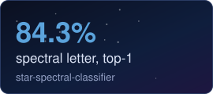
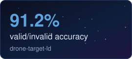
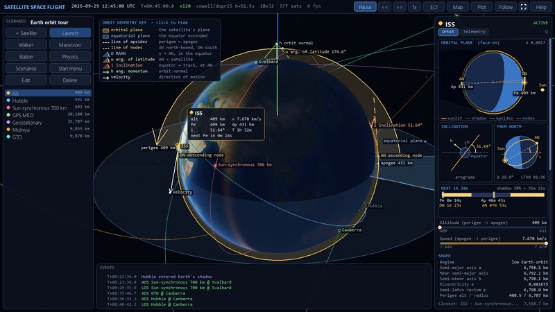
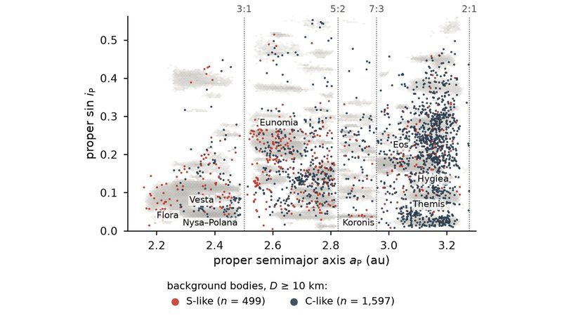
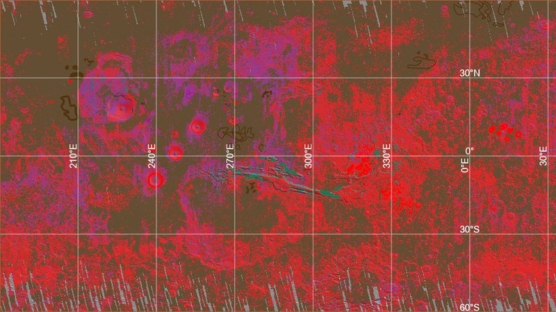
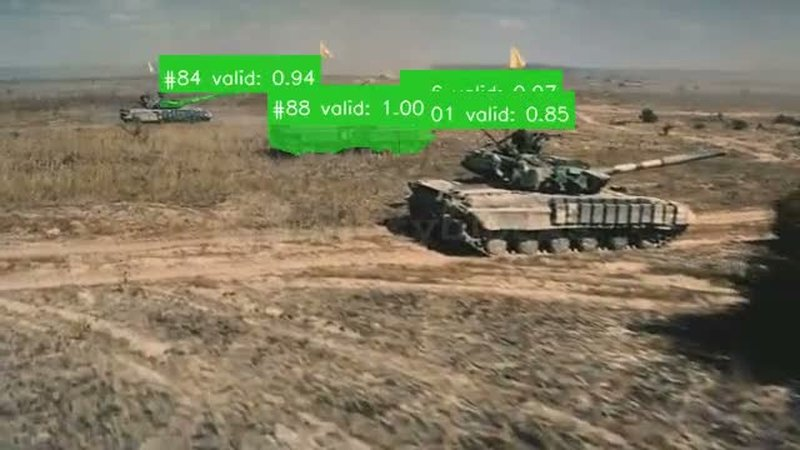

  
   
  
   
  
  
  
  

* 🔭 Astronomy & Astrophysics undergraduate at Florida Tech, with a second major in Planetary Science.
* ☄️ Latest paper: *Constraints on the Origin of the Asteroid Belt's Compositional Gradient from Debiased Taxonomic Data* ([asteroid-belt-gradient](https://github.com/loggger101/asteroid-belt-gradient)), testing whether the main belt's S/C gradient is primordial across 161,659 classified asteroids. Every figure and number in it regenerates from two public inputs.
* 🛰️ Building: [economicspace](https://github.com/loggger101/economicspace), a pipeline that asks whether an asteroid mining mission pays for itself, and [Satellite-Space-Flight](https://github.com/loggger101/Satellite-Space-Flight), an orbit simulator in pure Python.
* 🧬 Outside research: Chief Technology Officer at [AspireCURES](https://www.aspirecures.com) and Vice President of Database Management at [Sisters Hope Foundation](https://www.sistershopefoundation.org), building the platforms and patient databases for two rare-disease nonprofits.

  
  
  
  

<table>
  <tr>
    <td width="50%" align="center"> <b>Satellite-Space-Flight</b>: the ISS orbit, live elements and ground-station passes</td>
    <td width="50%" align="center"> <b>asteroid-belt-gradient</b>: S-like and C-like background bodies in proper elements</td>
  </tr>
  <tr>
    <td width="50%" align="center"> <b>Mars Global Mosaic</b>: SVM landform classes across Tharsis and Valles Marineris</td>
    <td width="50%" align="center"> <b>drone-target-id</b>: per-target valid/invalid scores on aerial footage</td>
  </tr>
</table>

### 🪐 Space economics

A four-repo stack answering whether an asteroid mining mission pays for itself:

| | |
|---|---|
| **[economicspace](https://github.com/loggger101/economicspace)** | The pipeline: build a catalog from public astronomy databases, price the minerals, cost the transportation, run the rocket equation and cost cascade to a ranked profitability table.    |
| **[AsteroidCatalog](https://github.com/loggger101/AsteroidCatalog)** | Its Stage 1, split out: about 1.57 million asteroids from JPL SBDB, SsODNet, NEOWISE and MP3C, cross-matched, provenance-tagged per value, and given a cited composition estimate per taxonomy class. Published as frozen, pinnable releases.     |
| **[spacecost](https://github.com/loggger101/spacecost)** | Its Stage 3, split out as an installable package: cited reference tables for mission cost and mass estimation, every row carrying an inline citation.     |
| **[General_Research](https://github.com/loggger101/General_Research)** | The evidence underneath all three, peer-reviewed and tiered-authoritative sources, with the numbers extracted to CSV per source.   |

### 🌑 Planetary science

| | |
|---|---|
| **[asteroid-belt-gradient](https://github.com/loggger101/asteroid-belt-gradient)** | Is the main belt's S/C compositional gradient primordial? A family-collapsed, size-debiased analysis of 161k classified asteroids from the catalog above. Every figure and number in the accompanying paper regenerates from two public inputs.      |
| **[Mars Global Mosaic](https://github.com/loggger101/Mars_Terrestrial_GlobalMosaic_GIS-Data)** | ArcGIS Pro project co-registering Viking color, THEMIS day/night infrared and HRSC/MOLA elevation at ±60° to map lava flows, fluvial channels and impact craters.   |

### 🧠 Deep learning

| | |
|---|---|
| **[star-spectral-classifier](https://github.com/loggger101/star-spectral-classifier)** | Multi-task CNN over Pan-STARRS RGB cutouts predicting Morgan-Keenan spectral letter and subclass digit, from photometry alone. 84.3% letter top-1 and 98.4% top-2 on 14k held-out cutouts. Finished 10/21/2025.     |
| **[drone-target-id](https://github.com/loggger101/drone-target-id)** | YOLO segmentation front-end feeding a multi-output CNN for aerial target identification, fine class and coarse valid/invalid. 87.6% fine-class and 91.2% valid/invalid accuracy on a 27k held-out test set. Finished 12/6/2025.      |

### 🚀 Simulation

| | |
|---|---|
| **[Satellite-Space-Flight](https://github.com/loggger101/Satellite-Space-Flight)** | Earth-centred 3-D orbit simulator in pure Python: a numpy physics engine (J2 to J4, drag, Sun/Moon, solar radiation pressure, manoeuvres) with an interactive pygame front end and multi-stage rocket launches.    |

### 🧬 Rare-disease platforms

I build and run the web platforms and patient databases for two rare-disease nonprofits. Both repos are private; the sites are live.

| | |
|---|---|
| **[AspireCURES](https://www.aspirecures.com)** | Chief Technology Officer. Patient-matching platform for rare brain diseases: static site on Cloudflare Pages with serverless registration and an automated research feed.    |
| **[Sisters Hope Foundation](https://www.sistershopefoundation.org)** | Vice President of Database Management. 501(c)(3) patient-advocacy nonprofit for ALSP and CSF1R-related disorders, rebuilt off Squarespace onto Cloudflare Pages.   |

### 🔗 Elsewhere

- **[website](https://github.com/loggger101/website)**: source for the portfolio site above, static HTML, CSS and vanilla JS with no build step.
- **[Hermes_Skills](https://github.com/loggger101/Hermes_Skills)**: 253 agent skills across 23 categories, kept as a working second brain.

📈 GitHub activity

 

  <picture>
    <source media="(prefers-color-scheme: dark)" srcset="https://github-profile-summary-cards.vercel.app/api/cards/profile-details?username=loggger101&theme=github_dark">
    
  </picture>

