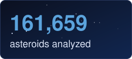
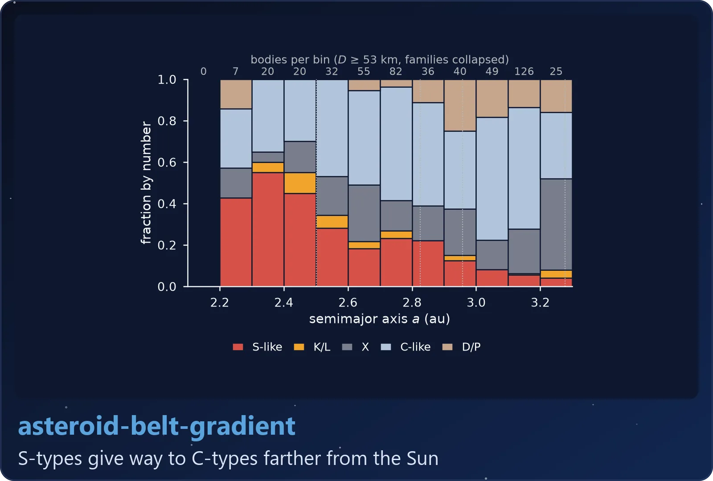
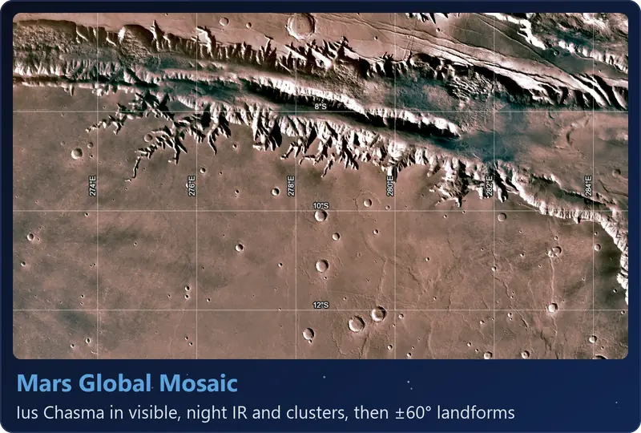
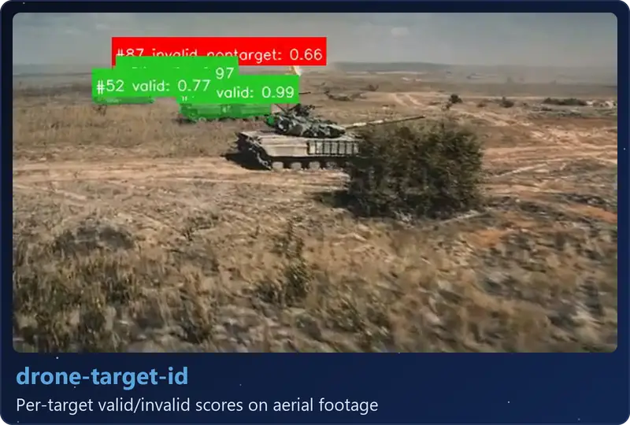
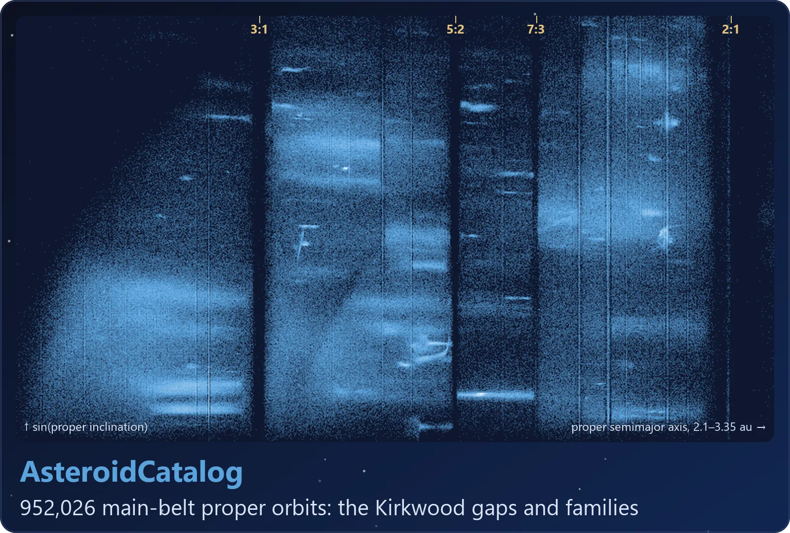
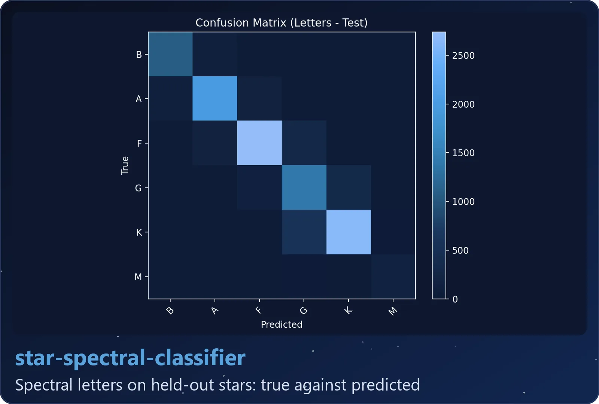
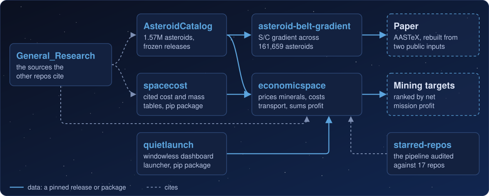

  
   
  <picture></picture>
   
  
  
  
  

I'm an Astronomy & Astrophysics student at Florida Tech, double majoring in Planetary Science. Most of the work here is about asteroids. I built a catalog of about 1.57 million of them and a pipeline that estimates whether mining one would make money, then used the catalog for a [paper](https://github.com/loggger101/asteroid-belt-gradient) on whether the belt's S/C composition gradient is left over from when the planets formed. I've also trained two image classifiers and written an orbit simulator.

Outside of school I'm CTO of [AspireCURES](https://www.aspirecures.com), a company that matches patients with rare brain diseases to research, and VP of Database Management at [Sisters Hope Foundation](https://www.sistershopefoundation.org), a rare-disease nonprofit. I run the websites and patient databases for both.

  <a href="#-space-economics">Space economics</a> · <a href="#-planetary-science">Planetary science</a> · <a href="#-deep-learning">Deep learning</a> · <a href="#-simulation">Simulation</a> · <a href="#-rare-disease-work">Rare-disease work</a> · <a href="#-elsewhere">Elsewhere</a> · <a href="#-every-commit-so-far">Commits</a> · <a href="#-languages">Languages</a> · <a href="#-passing-earth-this-week">Flybys</a> · <a href="#-get-in-touch">Contact</a>

  <a href="https://github.com/loggger101/AsteroidCatalog"><picture><source media="(max-width: 600px)" srcset="docs/stats/catalog-compact.svg"></picture></a>
  <a href="https://github.com/loggger101/asteroid-belt-gradient"><picture><source media="(max-width: 600px)" srcset="docs/stats/belt-compact.svg"></picture></a>
  <a href="https://github.com/loggger101/General_Research"><picture><source media="(max-width: 600px)" srcset="docs/stats/sources-compact.svg"></picture></a>
  <a href="https://github.com/loggger101/Hermes_Skills"><picture><source media="(max-width: 600px)" srcset="docs/stats/skills-compact.svg"></picture></a>

  <a href="https://github.com/loggger101/Satellite-Space-Flight"><picture><source media="(prefers-reduced-motion: reduce) and (max-width: 600px)" srcset="docs/gallery/satellite-compact.webp"><source media="(prefers-reduced-motion: reduce)" srcset="docs/gallery/satellite.webp"><source media="(max-width: 600px)" srcset="docs/gallery/satellite-motion-compact.webp"></picture></a>
  <a href="https://github.com/loggger101/asteroid-belt-gradient"><picture><source media="(max-width: 600px)" srcset="docs/gallery/belt-compact.webp"></picture></a>
  <a href="https://github.com/loggger101/Mars_Terrestrial_GlobalMosaic_GIS-Data"><picture><source media="(prefers-reduced-motion: reduce) and (max-width: 600px)" srcset="docs/gallery/mars-compact.webp"><source media="(prefers-reduced-motion: reduce)" srcset="docs/gallery/mars.webp"><source media="(max-width: 600px)" srcset="docs/gallery/mars-motion-compact.webp"></picture></a>
  <a href="https://github.com/loggger101/drone-target-id"><picture><source media="(prefers-reduced-motion: reduce) and (max-width: 600px)" srcset="docs/gallery/drone-compact.webp"><source media="(prefers-reduced-motion: reduce)" srcset="docs/gallery/drone.webp"><source media="(max-width: 600px)" srcset="docs/gallery/drone-motion-compact.webp"></picture></a>
  <a href="https://github.com/loggger101/AsteroidCatalog"><picture><source media="(max-width: 600px)" srcset="docs/gallery/catalog-compact.webp"></picture></a>
  <a href="https://github.com/loggger101/star-spectral-classifier"><picture><source media="(max-width: 600px)" srcset="docs/gallery/star-compact.webp"></picture></a>

### <picture></picture> Space economics

The first four repos work together to estimate whether an uncrewed asteroid mining mission would turn a profit, and the fifth checks the pipeline against other people's code. The catalog also feeds my paper.

  <picture><source media="(max-width: 600px)" srcset="docs/pipeline-compact.svg"></picture>

<table>
  <tr>
    <td width="24%" valign="top"><b><a href="https://github.com/loggger101/economicspace">economicspace</a></b> the pipeline 25,268 lines of code 98,204 total lines <picture></picture></td>
    <td valign="top">
The main pipeline. It builds a catalog from public astronomy databases, prices the minerals, costs the transport, then runs the rocket equation and a cost cascade to rank targets by profit.
<picture></picture> <picture></picture> <picture></picture></td>
  </tr>
  <tr>
    <td width="24%" valign="top"><b><a href="https://github.com/loggger101/AsteroidCatalog">AsteroidCatalog</a></b> Stage 1: the catalog 5,701 lines of code 13,599 total lines <picture></picture></td>
    <td valign="top">
The pipeline's catalog stage, moved into its own repo. About 1.57 million asteroids from JPL SBDB, SsODNet, NEOWISE and MP3C, cross-matched, with the source of every value recorded and a cited composition estimate for each taxonomy class. Releases are frozen so other projects can pin one.
<picture></picture> <picture></picture>  </td>
  </tr>
  <tr>
    <td width="24%" valign="top"><b><a href="https://github.com/loggger101/spacecost">spacecost</a></b> Stage 3: mission costs 8,725 lines of code 17,478 total lines <picture></picture></td>
    <td valign="top">
The pipeline's mission-cost stage as an installable Python package: reference tables for mission cost and mass, with a citation on every row.
<picture></picture> <picture></picture>  </td>
  </tr>
  <tr>
    <td width="24%" valign="top"><b><a href="https://github.com/loggger101/General_Research">General_Research</a></b> the sources 2,531 lines of code 48,602 total lines <picture></picture></td>
    <td valign="top">
The sources behind the three repos above, ranked into tiers by authority, with the numbers I use pulled into a CSV for each source.
</td>
  </tr>
  <tr>
    <td width="24%" valign="top"><b><a href="https://github.com/loggger101/starred-repos">starred-repos</a></b> pipeline audit 705 lines of code 2,528 total lines <picture></picture></td>
    <td valign="top">
An audit of 17 repos I'd starred, read for code and data the pipeline could use. Its probe scripts check economicspace's delta-v estimates against JPL's NHATS and against optimized Lambert transfers, and found two errors that partly cancel: the plane change is overcharged, and the transfer geometry undercharged by more.
<picture></picture> <picture></picture> <picture></picture></td>
  </tr>
</table>

**Where it stands.** One row for each place the pipeline can deliver to, from its latest full-catalog runs: what the best mission costs for each dollar its cargo earns (filled dot) and what the median asteroid's does (open dot). Left of the dashed line, a mission pays for itself; none does yet.

  <picture><source media="(max-width: 600px)" srcset="docs/breakeven-compact.svg"></picture>

### <picture></picture> Planetary science

<table>
  <tr>
    <td width="24%" valign="top"><b><a href="https://github.com/loggger101/asteroid-belt-gradient">asteroid-belt-gradient</a></b> paper and code 2,862 lines of code 6,529 total lines <picture></picture></td>
    <td valign="top">
Code and paper for <i>Constraints on the Origin of the Asteroid Belt's Compositional Gradient from Debiased Taxonomic Data</i>. It tests whether the belt's switch from S-types to C-types dates back to formation, using 161,659 classified asteroids from AsteroidCatalog after collapsing collisional families and correcting for the brightness bias that favors S-types. The code rebuilds every figure and number in the paper from two public input files.
<picture></picture> <picture></picture> <picture></picture>  </td>
  </tr>
  <tr>
    <td width="24%" valign="top"><b><a href="https://github.com/loggger101/Mars_Terrestrial_GlobalMosaic_GIS-Data">Mars Global Mosaic</a></b> Mars GIS mapping 18,769 lines of code 111,708 total lines <picture></picture></td>
    <td valign="top">
My project for OCN 4704 (Remote Sensing). In ArcGIS Pro I lined up Viking color, THEMIS day and night infrared, and HRSC/MOLA elevation between 60°N and 60°S to map lava flows, river channels and impact craters. A support vector machine classifies the landforms across that whole band, scoring 73.8% on areas it never trained on, and I've since trained RetinaNet and U-Net models to compare against it.
<picture></picture> <picture></picture> </td>
  </tr>
</table>

### <picture></picture> Deep learning

<table>
  <tr>
    <td width="24%" valign="top"><b><a href="https://github.com/loggger101/star-spectral-classifier">star-spectral-classifier</a></b> stellar classification 2,946 lines of code 7,333 total lines <picture></picture></td>
    <td valign="top">
A multi-task CNN that predicts a star's Morgan-Keenan spectral letter and subclass digit from Pan-STARRS color cutouts, without any spectra. On 14k held-out cutouts it gets the letter right 84.3% of the time, and 98.4% within its top two guesses. Finished October 2025.
<picture></picture> <picture></picture>  </td>
  </tr>
  <tr>
    <td width="24%" valign="top"><b><a href="https://github.com/loggger101/drone-target-id">drone-target-id</a></b> aerial target ID 1,509 lines of code 4,779 total lines <picture></picture></td>
    <td valign="top">
YOLO finds and segments targets in aerial footage, then a multi-output CNN gives each one a fine class and a valid/invalid call. On a 27k held-out test set it scores 87.1% on fine class and 91.3% on valid/invalid. Finished December 2025.
<picture></picture> <picture></picture> <picture></picture>  </td>
  </tr>
</table>

### <picture></picture> Simulation

<table>
  <tr>
    <td width="24%" valign="top"><b><a href="https://github.com/loggger101/Satellite-Space-Flight">Satellite-Space-Flight</a></b> orbit simulator 12,796 lines of code 22,010 total lines <picture></picture></td>
    <td valign="top">
A 3-D Earth orbit simulator in pure Python. The physics runs in numpy (J2 to J4 gravity, drag, Sun and Moon, solar radiation pressure, maneuvers) and pygame draws it. You can also fly a multi-stage rocket to orbit from anywhere on Earth, or from one of fifteen real launch complexes.
<picture></picture> <picture></picture> <picture></picture></td>
  </tr>
</table>

### <picture></picture> Rare-disease work

Both repos are private, but the sites are public.

<table>
  <tr>
    <td width="24%" valign="top"><b><a href="https://www.aspirecures.com">AspireCURES</a></b> CTO 10,712 lines of code 20,801 total lines <picture></picture></td>
    <td valign="top">
AspireCURES connects patients with rare brain diseases such as CSF1R-ALSP to clinical trials, studies and specialists. Its site runs on Cloudflare Pages with serverless registration, and I've built a weekly research feed for its nine disease pages.
<picture></picture>  </td>
  </tr>
  <tr>
    <td width="24%" valign="top"><b><a href="https://www.sistershopefoundation.org">Sisters Hope Foundation</a></b> VP, Database Management 5,219 lines of code 11,270 total lines <picture></picture></td>
    <td valign="top">
Sisters Hope is a 501(c)(3) patient advocacy group for ALSP and CSF1R-related disorders. I moved their site off Squarespace and onto Cloudflare Pages.
<picture></picture> </td>
  </tr>
</table>

### <picture></picture> Elsewhere

<!-- GitHub sizes each table to its content. Two of these descriptions are short, so the spacer image (1px tall, transparent) widens the table to match the others; on phones it shrinks to nothing. -->
<table>
  <tr>
    <td width="24%" valign="top"><b><a href="https://github.com/loggger101/website">website</a></b> portfolio site 7,615 lines of code 10,124 total lines <picture></picture></td>
    <td valign="top">
The code for my portfolio site. Plain HTML, CSS and JavaScript with no build step.
<picture></picture> <picture></picture> <picture></picture>   <picture></picture></td>
  </tr>
  <tr>
    <td width="24%" valign="top"><b><a href="https://github.com/loggger101/quietlaunch">quietlaunch</a></b> Streamlit launcher 1,077 lines of code 2,202 total lines <picture></picture></td>
    <td valign="top">
Starts a Streamlit app with no console window. A small control window shows the server booting, and why it failed if it does, opens the browser once the port answers, and stops the server and its children when closed. I split it out of economicspace's dashboard launcher; it uses only the standard library and is tested on Windows, Linux and macOS.
<picture></picture> <picture></picture> </td>
  </tr>
  <tr>
    <td width="24%" valign="top"><b><a href="https://github.com/loggger101/quietqueue">quietqueue</a></b> unattended job queue 646 lines of code 1,589 total lines <picture></picture></td>
    <td valign="top">
Runs a queue of long jobs unattended on Windows and keeps it alive through a closed shell, a stray Ctrl+C, a reboot or a second copy started at logon. Each job is one subprocess, a ledger records what's finished so a restart picks up where it stopped, and the whole process tree can be paused and resumed without losing the job in flight. I split it out of economicspace's campaign runner, which ran a 28-job model campaign over several days.
<picture></picture> </td>
  </tr>
  <tr>
    <td width="24%" valign="top"><b><a href="https://github.com/loggger101/Hermes_Skills">Hermes_Skills</a></b> agent skills <picture></picture></td>
    <td valign="top">
My library of 253 agent skills in 23 categories, built for my Hermes agent setup.
<picture></picture> <picture></picture></td>
  </tr>
</table>

### <picture></picture> Every commit so far

Every commit I've made to the repos above, from the first to this week. Each ring is one section of this page, the outermost the first; time runs clockwise from twelve o'clock, and a bigger dot is a busier week. Bots' commits aren't counted.

  <picture><source media="(max-width: 600px)" srcset="docs/activity-compact.svg"></picture>

My latest commits:

<!-- latest commits -->
- 23 Oct · [Mars Global Mosaic](https://github.com/loggger101/Mars_Terrestrial_GlobalMosaic_GIS-Data/commit/cdac6d75d9f4f2c7d8f7766468186a8d484d9019): The label proposals built on the drive: 1,086 rows, the laptop's result exactly
- 23 Oct · [Mars Global Mosaic](https://github.com/loggger101/Mars_Terrestrial_GlobalMosaic_GIS-Data/commit/e11642d6741d03d4b351e48535689d411ade6eda): The final started: AASTeX paper and final deck, and the drive merged with §68
- 22 Oct · [General_Research](https://github.com/loggger101/General_Research/commit/f846ef86da9911b955c29117d23acb1a65e7b8d9): Round 240: owner rejects 8 sources; new "Sources to replace" list with 15 flags
- 22 Oct · [General_Research](https://github.com/loggger101/General_Research/commit/5418e8879a66ad91b9d3eda61258a634b000619d): Round 239: source audit; owner rejects 25 sources that back no cell or that upstream stopped citing
- 21 Oct · [starred-repos](https://github.com/loggger101/starred-repos/commit/223bfef746d4e9c5fdf37552f9b0268d61be9991): README: economicspace's orbital.py keeps only elements\_to\_state; the solvers are here alone
- 21 Oct · [spacecost](https://github.com/loggger101/spacecost/commit/643a7832ddcfd99eecc202ebfa2c36b7e8b175e6): Cut 0.12.6: seven wording and citation RCs (data contract 1.23.6)
<!-- /latest commits -->

### <picture></picture> Languages

The lines of code under each repo's name, added up by language.

  <picture><source media="(max-width: 600px)" srcset="docs/languages-compact.svg"></picture>

### <picture></picture> Passing Earth this week

The asteroids coming within 20 lunar distances of Earth in the week ahead, from NASA/JPL's close-approach data, refreshed every Monday. The sizes are estimates from each body's brightness, as almost none has been measured.

  <picture><source media="(max-width: 600px)" srcset="docs/flybys-compact.svg"></picture>

### <picture></picture> Get in touch

The contact form on my site goes straight to my email, or you can message me on LinkedIn.

  
  

The charts, counts and cards on this page are drawn by Python scripts from the repos' own data, and most of them refresh every Monday. <a href="https://github.com/loggger101/Loggger101/tree/main/tools">See how they're made</a>.

 

<picture><source media="(max-width: 600px)" srcset="docs/footer-compact.svg"></picture>

