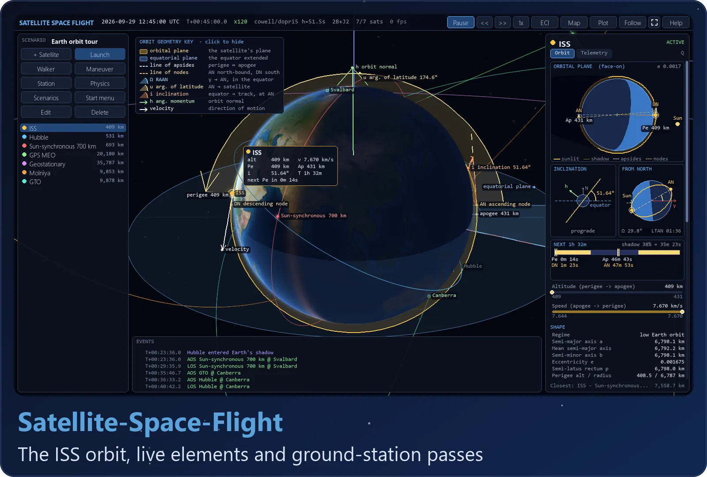
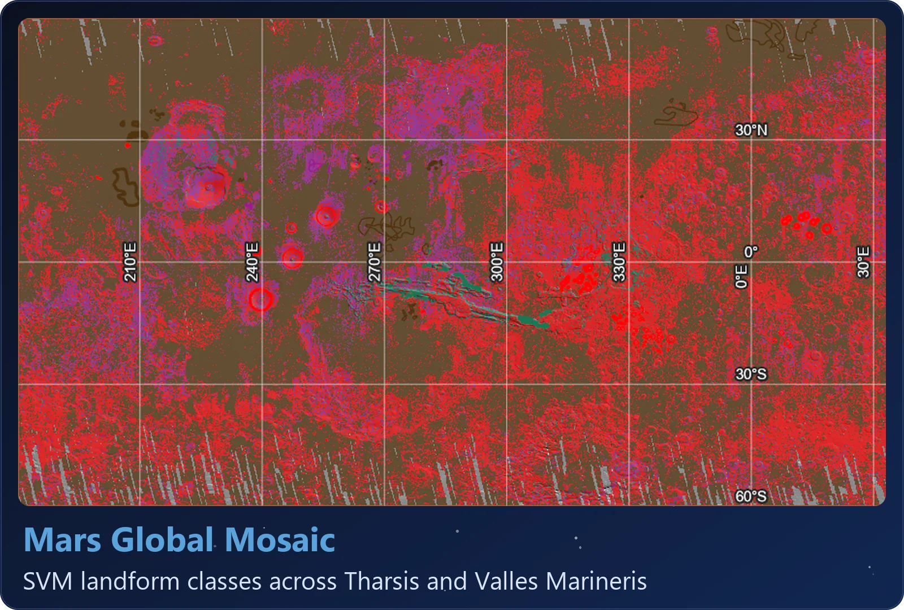
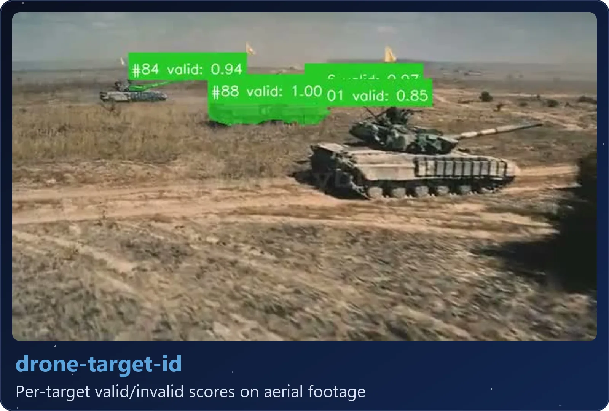

  
   
  
   
  
  
  
  

I'm an Astronomy & Astrophysics student at Florida Tech, double majoring in Planetary Science. Most of the work here is about asteroids. I built a catalog of about 1.57 million of them and a pipeline that estimates whether mining one would make money, then used the catalog for a [paper](https://github.com/loggger101/asteroid-belt-gradient) on whether the belt's S/C composition gradient is left over from when the planets formed. I've also trained two image classifiers and written an orbit simulator.

Outside of school I'm CTO of [AspireCURES](https://www.aspirecures.com), a company that matches patients with rare brain diseases to research, and VP of Database Management at [Sisters Hope Foundation](https://www.sistershopefoundation.org), a rare-disease nonprofit. I run the websites and patient databases for both.

  <a href="https://github.com/loggger101/AsteroidCatalog"><picture><source media="(max-width: 600px)" srcset="docs/stats/catalog-compact.svg"></picture></a>
  <a href="https://github.com/loggger101/asteroid-belt-gradient"><picture><source media="(max-width: 600px)" srcset="docs/stats/belt-compact.svg"></picture></a>
  <a href="https://github.com/loggger101/General_Research"><picture><source media="(max-width: 600px)" srcset="docs/stats/sources-compact.svg"></picture></a>
  <a href="https://github.com/loggger101/Hermes_Skills"><picture><source media="(max-width: 600px)" srcset="docs/stats/skills-compact.svg"></picture></a>

  <a href="https://github.com/loggger101/Satellite-Space-Flight"><picture><source media="(max-width: 600px)" srcset="docs/gallery/satellite-compact.webp"></picture></a>
  <a href="https://github.com/loggger101/asteroid-belt-gradient"><picture><source media="(max-width: 600px)" srcset="docs/gallery/belt-compact.webp"></picture></a>
  <a href="https://github.com/loggger101/Mars_Terrestrial_GlobalMosaic_GIS-Data"><picture><source media="(max-width: 600px)" srcset="docs/gallery/mars-compact.webp"></picture></a>
  <a href="https://github.com/loggger101/drone-target-id"><picture><source media="(max-width: 600px)" srcset="docs/gallery/drone-compact.webp"></picture></a>

###  Space economics

These four repos work together to estimate whether an uncrewed asteroid mining mission would turn a profit. The catalog also feeds my paper.

  <picture><source media="(max-width: 600px)" srcset="docs/pipeline-compact.svg"></picture>

<table>
  <tr>
    <td width="24%" valign="top"><b><a href="https://github.com/loggger101/economicspace">economicspace</a></b> the pipeline 22,606 lines of code</td>
    <td valign="top">
The main pipeline. It builds a catalog from public astronomy databases, prices the minerals, costs the transport, then runs the rocket equation and a cost cascade to rank targets by profit.
  </td>
  </tr>
  <tr>
    <td width="24%" valign="top"><b><a href="https://github.com/loggger101/AsteroidCatalog">AsteroidCatalog</a></b> Stage 1: the catalog 5,609 lines of code</td>
    <td valign="top">
The pipeline's catalog stage, moved into its own repo. About 1.57 million asteroids from JPL SBDB, SsODNet, NEOWISE and MP3C, cross-matched, with the source of every value recorded and a cited composition estimate for each taxonomy class. Releases are frozen so other projects can pin one.
   </td>
  </tr>
  <tr>
    <td width="24%" valign="top"><b><a href="https://github.com/loggger101/spacecost">spacecost</a></b> Stage 3: mission costs 8,311 lines of code</td>
    <td valign="top">
The pipeline's mission-cost stage as an installable Python package: reference tables for mission cost and mass, with a citation on every row.
   </td>
  </tr>
  <tr>
    <td width="24%" valign="top"><b><a href="https://github.com/loggger101/General_Research">General_Research</a></b> the sources 2,397 lines of code</td>
    <td valign="top">
The sources behind the other three, ranked into tiers by authority, with the numbers I use pulled into a CSV for each source.
</td>
  </tr>
</table>

###  Planetary science

<table>
  <tr>
    <td width="24%" valign="top"><b><a href="https://github.com/loggger101/asteroid-belt-gradient">asteroid-belt-gradient</a></b> paper and code 2,862 lines of code</td>
    <td valign="top">
Code and paper for <i>Constraints on the Origin of the Asteroid Belt's Compositional Gradient from Debiased Taxonomic Data</i>. It tests whether the belt's switch from S-types to C-types dates back to formation, using 161,659 classified asteroids from AsteroidCatalog after collapsing collisional families and correcting for the brightness bias that favors S-types. The code rebuilds every figure and number in the paper from two public input files.
    </td>
  </tr>
  <tr>
    <td width="24%" valign="top"><b><a href="https://github.com/loggger101/Mars_Terrestrial_GlobalMosaic_GIS-Data">Mars Global Mosaic</a></b> Mars GIS mapping 14,445 lines of code</td>
    <td valign="top">
My project for OCN 4704 (Remote Sensing). In ArcGIS Pro I lined up Viking color, THEMIS day and night infrared, and HRSC/MOLA elevation between 60°N and 60°S, then mapped lava flows, river channels and impact craters.
 </td>
  </tr>
</table>

###  Deep learning

<table>
  <tr>
    <td width="24%" valign="top"><b><a href="https://github.com/loggger101/star-spectral-classifier">star-spectral-classifier</a></b> stellar classification 2,946 lines of code</td>
    <td valign="top">
A multi-task CNN that predicts a star's Morgan-Keenan spectral letter and subclass digit from Pan-STARRS color cutouts, without any spectra. On 14k held-out cutouts it gets the letter right 84.3% of the time, and 98.4% within its top two guesses. Finished 10/21/2025.
   </td>
  </tr>
  <tr>
    <td width="24%" valign="top"><b><a href="https://github.com/loggger101/drone-target-id">drone-target-id</a></b> aerial target ID 1,509 lines of code</td>
    <td valign="top">
YOLO finds and segments targets in aerial footage, then a multi-output CNN gives each one a fine class and a valid/invalid call. On a 27k held-out test set it scores 87.1% on fine class and 91.3% on valid/invalid. Finished 12/6/2025.
    </td>
  </tr>
</table>

###  Simulation

<table>
  <tr>
    <td width="24%" valign="top"><b><a href="https://github.com/loggger101/Satellite-Space-Flight">Satellite-Space-Flight</a></b> orbit simulator 12,796 lines of code</td>
    <td valign="top">
A 3-D Earth orbit simulator in pure Python. The physics runs in numpy (J2 to J4 gravity, drag, Sun and Moon, solar radiation pressure, maneuvers) and pygame draws it. You can also fly a multi-stage rocket to orbit from anywhere on Earth, or from one of fifteen real launch complexes.
  </td>
  </tr>
</table>

###  Rare-disease work

Both repos are private, but the sites are public.

<table>
  <tr>
    <td width="24%" valign="top"><b><a href="https://www.aspirecures.com">AspireCURES</a></b> CTO 9,961 lines of code</td>
    <td valign="top">
AspireCURES connects patients with rare brain diseases such as CSF1R-ALSP to clinical trials, studies and specialists. Its site runs on Cloudflare Pages with serverless registration, and I've built a weekly research feed for its nine disease pages.
  </td>
  </tr>
  <tr>
    <td width="24%" valign="top"><b><a href="https://www.sistershopefoundation.org">Sisters Hope Foundation</a></b> VP, Database Management 5,219 lines of code</td>
    <td valign="top">
Sisters Hope is a 501(c)(3) patient advocacy group for ALSP and CSF1R-related disorders. I moved their site off Squarespace and onto Cloudflare Pages.
 </td>
  </tr>
</table>

###  Elsewhere

<!-- GitHub sizes each table to its content. These two descriptions are short, so the spacer image (1px tall, transparent) widens the table to match the others; on phones it shrinks to nothing. -->
<table>
  <tr>
    <td width="24%" valign="top"><b><a href="https://github.com/loggger101/website">website</a></b> portfolio site 7,577 lines of code</td>
    <td valign="top">
The code for my portfolio site. Plain HTML, CSS and JavaScript with no build step.
     </td>
  </tr>
  <tr>
    <td width="24%" valign="top"><b><a href="https://github.com/loggger101/Hermes_Skills">Hermes_Skills</a></b> agent skills</td>
    <td valign="top">
My library of 253 agent skills in 23 categories, built for my Hermes agent setup.
 </td>
  </tr>
</table>

###  Get in touch

The contact form on my site goes straight to my email, or you can message me on LinkedIn.

  
  

 

<picture><source media="(max-width: 600px)" srcset="docs/footer-compact.svg"></picture>

